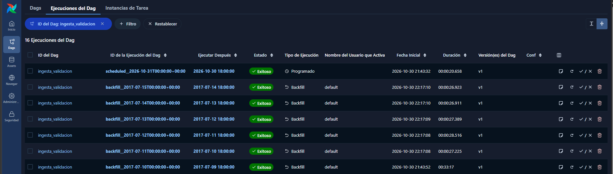
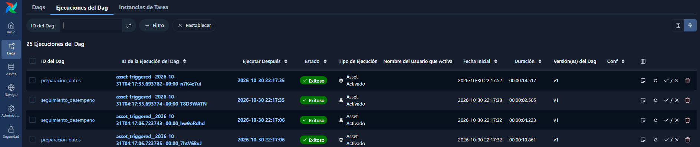

# Motor de Reposición de Inventario (Lab 1, Maestría en Data Science)

Producto de ML reproducible con Git, DVC y Airflow 3 para la Corporación Favorita (Kaggle): ingesta con validación, pronóstico probabilístico por tienda y familia (horizonte 7 días), pedido sugerido por newsvendor y seguimiento del desempeño.

**Tabla de contenido:** [Resultados](#resultados) · [Puesta en marcha](#puesta-en-marcha) · [DVC](#dvc-datos-pipeline-y-reproducibilidad) · [Airflow](#airflow-3-docker) · [Evidencia](#evidencia) · [Decisiones](DECISIONES.md)

## Requisitos
Python 3.12+ (las versiones de pandas, numpy y lightgbm están fijadas en `requirements.txt`), Docker y Docker Compose, Git, DVC.


## Resultados

### Backtest: baseline vs LightGBM (rolling-origin, 4 folds, datos reales)

Cada fold lee la información tal como estaba disponible a su corte. Detalle en `reports/backtest_2017-06-30.csv`.

| Fold | Corte | Costo baseline | Costo LightGBM | Mejora costo | Pinball baseline | Pinball LightGBM |
|---|---|---|---|---|---|---|
| 1 | 2017-05-12 | 1,792,262 | 1,690,337 | 5.7% | 29.20 | 26.33 |
| 2 | 2017-05-26 | 1,967,910 | 1,570,598 | 20.2% | 28.38 | 24.77 |
| 3 | 2017-06-09 | 1,329,044 | 1,229,323 | 7.5% | 19.32 | 19.59 |
| 4 | 2017-06-23 | 1,505,902 | 1,312,642 | 12.8% | 22.05 | 20.44 |

- **Criterio de reemplazo:** el retador reemplaza al vigente si baja el costo de negocio >= 2% en al menos 3 de 4 folds **y** su pinball promedio no empeora.
- **Decisión:** `reemplaza = true`. Mejoró el costo en 4 de 4 folds y el pinball promedio bajó 7.9%. El modelo vigente es `lgbm` (`config/vigente.json`).
- **Salvedad:** en el fold 3 el pinball de LightGBM es ligeramente peor (19.59 contra 19.32), aunque el costo y el WAPE mejoran. El criterio se evalúa sobre el promedio.
- La mejora de 20% del fold 2 es la más grande; no investigué su causa. Una hipótesis a verificar es un efecto de calendario (por ejemplo, el Día de la Madre).

### Seguimiento del desempeño (corte 2017-08-14)

Compara cada pronóstico publicado contra las ventas reales que ya llegaron a ese corte (`data/seguimiento/corte=2017-08-14/seguimiento.csv`).

| Pronóstico | Modelo | Semana evaluada | Pinball | WAPE | Costo | Cobertura q10-q90 (nominal 80%) |
|---|---|---|---|---|---|---|
| 2017-07-02 | lgbm | 07-02 a 07-08 | 21.21 | 10.6% | 1,233,493 | 82.7% |
| 2017-07-09 | lgbm | 07-09 a 07-15 | 19.78 | 11.4% | 1,274,603 | 83.7% |
| 2017-07-31 | baseline | 07-31 a 08-06 | 33.02 | 16.7% | 2,304,923 | 65.5% |

El intervalo de LightGBM cubrió 83% de las observaciones con 80% nominal, lo que indica buena calibración. El pronóstico del 31 de julio lo generó DVC con el baseline, antes de promover el modelo. Cubre otra semana, así que **no es una comparación entre modelos**: es solo el registro de ese pronóstico.

### Reproducción de un pronóstico pasado

`scripts/verificar_pronostico.py` regenera el pronóstico de un corte con los datos tal como estaban entonces (lectura as-of) y compara el SHA256 del CSV con el publicado.

```
python scripts/verificar_pronostico.py --corte 2017-07-02
{'corte': '2017-07-02', 'modelo': 'lgbm_2017-07-01', 'igual': True,
 'sha_publicado':   'a658d22e56872e5e72f248f1780d9f7fa8c735c31c2ffbcdbd2cfc644b36a2f0',
 'sha_regenerado':  'a658d22e56872e5e72f248f1780d9f7fa8c735c31c2ffbcdbd2cfc644b36a2f0'}
```

Este pronóstico lo generó Airflow dentro del contenedor y se regeneró fuera de él, en el entorno de `requirements.txt`. Con una versión distinta de pandas (3.1.0 en vez de 3.0.5) el SHA cambia en decimales, por eso las versiones están fijadas.

## Puesta en marcha

```bash
python -m venv .venv && source .venv/bin/activate
pip install -r requirements.txt

# 1. Descargar de Kaggle (store-sales-time-series-forecasting) y colocar en data/raw/:
#    train.csv, stores.csv, holidays_events.csv, oil.csv, transactions.csv

# 2. Generar carga histórica y bandeja
python scripts/generar_bandeja.py --raw data/raw --salida data

# 3. Pruebas
pytest -q
```

```bash
# 4. Validar e ingerir lo que haya llegado hasta un corte (código de salida 1 si hay cuarentena)
python scripts/ingestar.py --corte 2017-06-30

# 5. Backtest baseline vs LightGBM y decisión de reemplazo (escribe reports/)
python scripts/backtest.py --corte 2017-06-30 --promover

# 6. Pronóstico y pedido sugerido para un corte
python scripts/pronosticar.py --corte 2017-06-30 --modelo vigente
```

```bash
# 7. Seguimiento: compara pronósticos publicados contra lo real que ya llegó al corte
python scripts/seguimiento.py --corte 2017-08-14

# 8. Reproducir un pronóstico pasado con los datos tal como estaban (compara SHA del CSV publicado)
python scripts/verificar_pronostico.py --corte 2017-06-30
```

La reproducción es exacta (mismo SHA del CSV) cuando se usan las versiones fijadas en `requirements.txt` (pandas 3.0.5, numpy 2.5.3, lightgbm 4.7.0), que son las del contenedor de Airflow. Con otra versión de pandas el resultado difiere en decimales. Dentro del contenedor:

```bash
docker compose exec -T -w /opt/airflow/proyecto airflow-worker python scripts/verificar_pronostico.py --corte 2017-07-02
```

## DVC (datos, pipeline y reproducibilidad)

```bash
dvc init
dvc remote add -d local ~/dvc_remoto      # remoto local; puede ser S3/GCS/etc.
dvc add data/raw                          # datos crudos de Kaggle
dvc repro                                 # bandeja -> ingesta -> features -> entrenamiento -> pronostico -> seguimiento
dvc push
git add dvc.yaml dvc.lock params.yaml data/raw.dvc data/.gitignore config/vigente.json
```

- Los cortes se cambian en `params.yaml` (`corte`, `corte_seguimiento`). Las salidas llevan `persist: true`: un corte nuevo **no borra** los anteriores.
- `data/.gitignore` lo mantiene DVC. No pongas una regla `data/*` en el `.gitignore` raíz (rompe `dvc checkout`).
- Para recuperar todo en otra máquina: `git clone` + `dvc pull`.

## Airflow 3 (Docker)

```bash
curl -LfO 'https://airflow.apache.org/docs/apache-airflow/3.3.2/docker-compose.yaml'   # y se versiona
mkdir -p airflow/{logs,plugins,config,dags}
cp .env.example .env                       # ajustar AIRFLOW_UID con `id -u`
docker build -t lab1-airflow:latest .
docker compose up airflow-init
docker compose up -d                       # UI: http://localhost:8080  (airflow / airflow)
bash scripts/backfill.sh                   # despausa los DAGs y lanza backfill
```

DAGs: `ingesta_validacion` (diario) -> asset `bandeja_procesada` -> `preparacion_datos` y `seguimiento_desempeno`; `pronostico_pedido` (semanal). Toda la lógica está en `src/inventario/`.


## Evidencia

Capturas de Airflow 3 con datos reales de Favorita (backfill de julio de 2017). Los estados se ven en la columna "Estado" de cada captura.

**1. `ingesta_validacion`: backfill diario en verde**



**2. `pronostico_pedido`: corridas semanales del 2017-07-02 y 2017-07-09 en verde**


La corrida `scheduled__2026-10-25` aparece en rojo. Airflow la lanzó solo al despausar el DAG, con una fecha lógica (2026) muy posterior a los datos simulados (hasta 2017). No forma parte del backfill. Limitación conocida: los DAGs deberían acotarse al periodo simulado con `end_date`, o mantenerse pausados fuera del backfill.

**3. `preparacion_datos` y `seguimiento_desempeno`: activados por el asset `bandeja_procesada`**



Estas corridas son del 30 de octubre de 2026, del encadenamiento que se disparó tras la ingesta de ese día. Muestran que ambos DAGs arrancan solos cuando la ingesta publica el asset.

La corrida `backfill__2017-07-10` de `ingesta_validacion` dura 33 minutos porque quedó esperando mientras WSL se quedó sin memoria, y terminó bien al recuperarse.

## Entrega

Tag `entrega-lab1`. `main` está protegida: los cambios entran por Pull Request con el check `pytest` en verde. Las decisiones de diseño están en [DECISIONES.md](DECISIONES.md).
